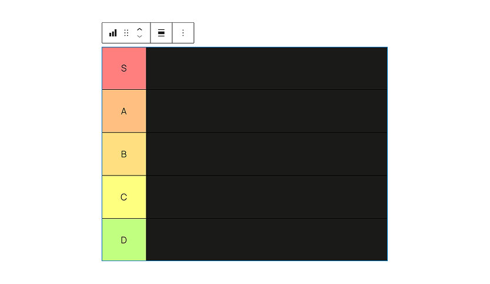

# Tier List Block

[](https://github.com/philhoyt/TierListBlock/actions/workflows/ci.yml)
[](https://playground.wordpress.net/?blueprint-url=https://raw.githubusercontent.com/philhoyt/TierListBlock/main/_playground/blueprint.json)

A WordPress block for building TierMaker-style ranking lists in the block editor.



A new tier list starts with five rows labelled S, A, B, C and D. Each row has a label cell and a content zone that accepts any block. The published page is static HTML and CSS; no JavaScript is loaded for visitors.

## Requirements

- WordPress 6.6 or later
- PHP 7.4 or later

## Installation

1. Download `tier-list-block.zip` from the latest [release](https://github.com/philhoyt/TierListBlock/releases).
2. Upload it under Plugins > Add New Plugin > Upload Plugin and activate it.

Updates are delivered from GitHub releases through the bundled Plugin Update Checker. The Playground badge above installs the latest release zip with demo content.

## Usage

Insert the Tier List block. The sidebar Tiers panel has an Add Tier Row button; new rows get a green label. Rename a label by editing its paragraph, recolour it with the label's background and text colour controls, reorder rows with the block mover, and delete a row like any other block.

The plugin registers four blocks. Only the outer one appears in the inserter.

| Block | Role | Notes |
|---|---|---|
| `tier-list/tier-list` | Outer wrapper | Allows only `tier-item` children. Background colour, wide and full alignment. |
| `tier-list/tier-item` | One row | Locked to one label and one content zone. Background colour. |
| `tier-list/tier-label` | Rank label cell | Holds a centred paragraph. Background and text colour. |
| `tier-list/tier-content` | Content zone | Accepts every registered block except `core/gallery` and `core/group`. Text colour. |

Items in a content zone sit in a wrapping flex row with an 8 px gap. Below 480 px the label stacks above the content.

Gallery and Group are excluded from the content zone because the editor auto-transforms adjacent images into them, which breaks the row.

## Development

```bash
npm install
composer install
npm run build
```

- `npm start` runs the webpack watch.
- `npm run build` writes the four blocks to `build/`.
- `npm run lint:js`, `npm run lint:css` and `npm run lint:php` run ESLint, Stylelint and PHP CodeSniffer (`composer lint` is the same as the last one).
- `composer analyse` runs PHPStan.
- `npm run env:start` starts wp-env; `npm run test:php` then runs the PHPUnit tests in `tests/phpunit/` inside it.
- `npm run test:unit` runs the Vitest JS tests. There are none yet; the script passes with no tests.
- `npm run plugin-zip` builds `tier-list-block.zip` from the `files` list in `package.json`.

CI runs `composer audit`, the linters, PHPStan, the build, Vitest and PHPUnit on every pull request.

## Releases

Bump the version in `tier-list.php`, `package.json`, every `src/*/block.json` and `readme.txt` (a PHPUnit test checks they match), add a changelog entry, commit, then push a lowercase `v`-prefixed tag:

```bash
git tag v1.0.4 && git push origin v1.0.4
```

The release workflow builds the assets, runs `wp-scripts plugin-zip`, and creates a GitHub release with the matching changelog section as its body and `tier-list-block.zip` and `readme.txt` attached. The 1.0.0 and 1.0.1 tags were uppercase `V`, which the update checker did not recognise; use lowercase.

## Limitations

- Visitors cannot drag items between tiers. Ranking happens in the editor only.
- Gallery and Group blocks cannot be placed in a tier's content zone.
- There is no import or export of tier lists; each one is block content in the post.
